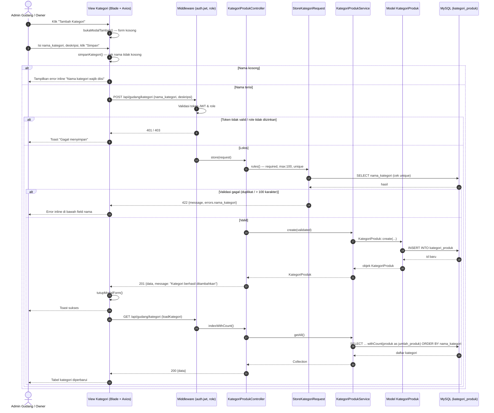
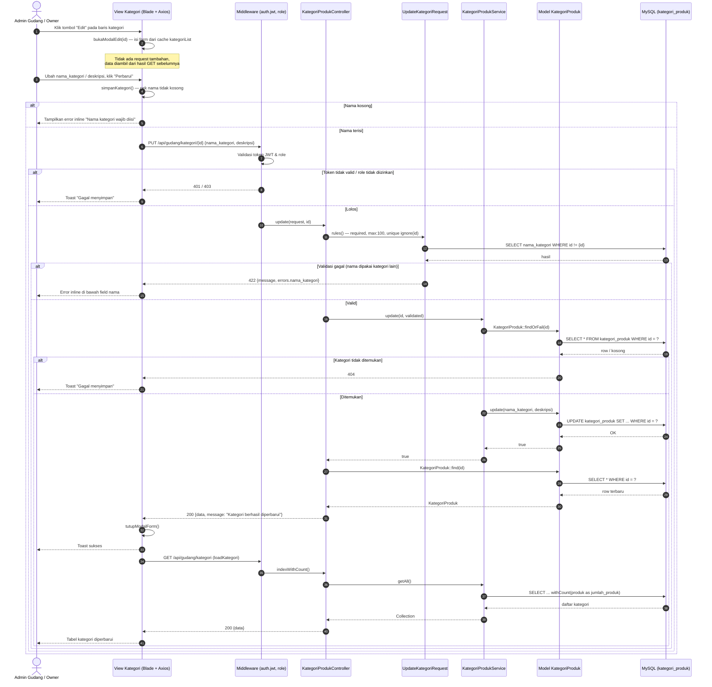
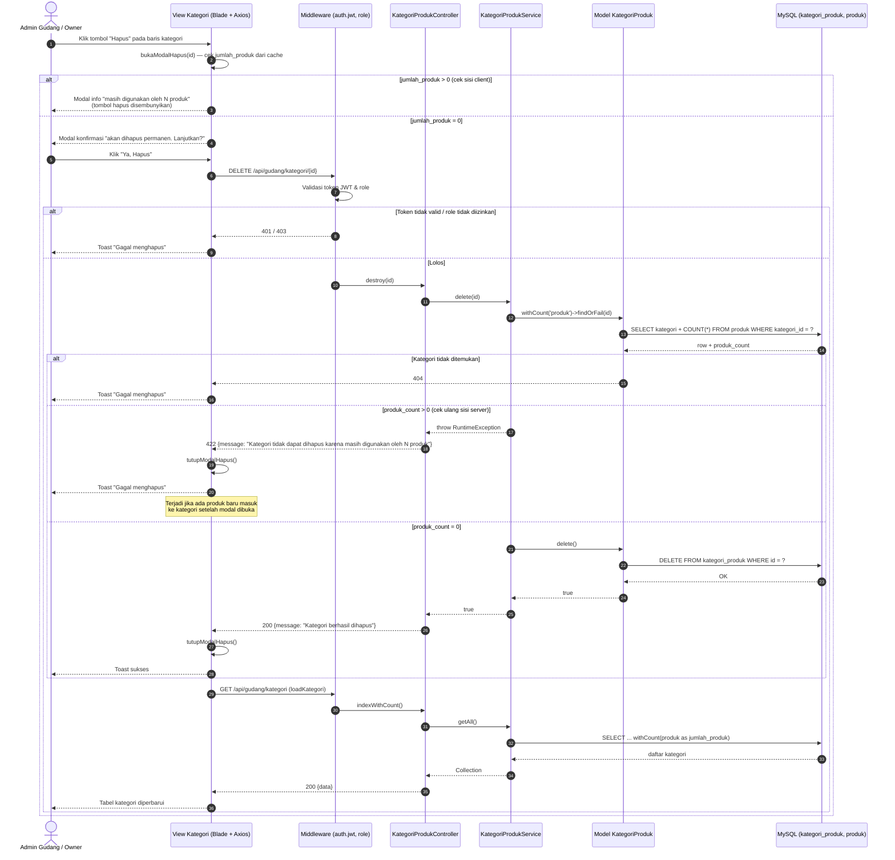

# Sequence Diagram — Manajemen Kategori Produk (SD-16)

> Diturunkan dari implementasi aktual:
> - View: `resources/views/gudang/kategori/index.blade.php`
> - Route: `routes/api.php` (group `auth.jwt` + `role:admin_gudang,owner`, prefix `gudang`)
> - Controller: `KategoriProdukController`
> - FormRequest: `StoreKategoriRequest`, `UpdateKategoriRequest`
> - Service: `Inventory\KategoriProdukService`
> - Model: `KategoriProduk` → tabel `kategori_produk`
>
> Kategori adalah **data referensi** → operasi **sinkron**, **tidak lewat Kafka**.

---

## SD-16a: Tambah Kategori

---

## SD-16b: Edit Kategori

---

## SD-16c: Hapus Kategori

