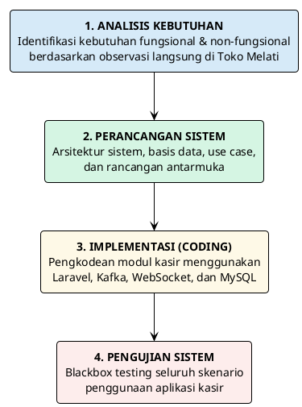
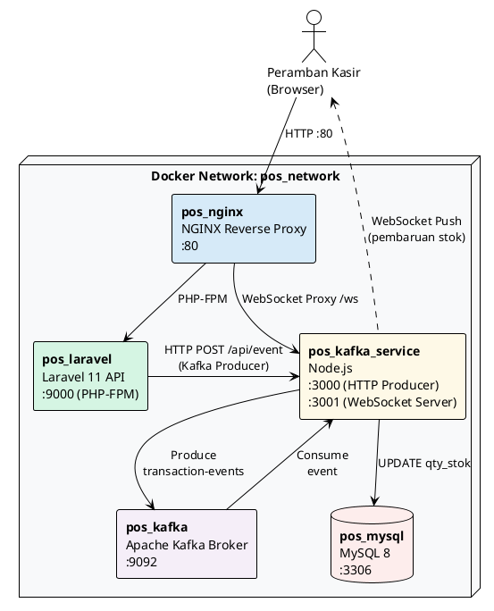
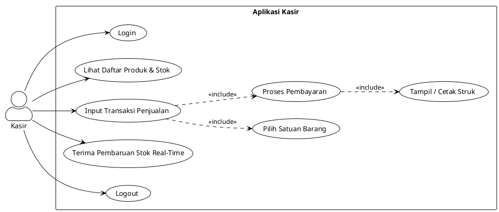
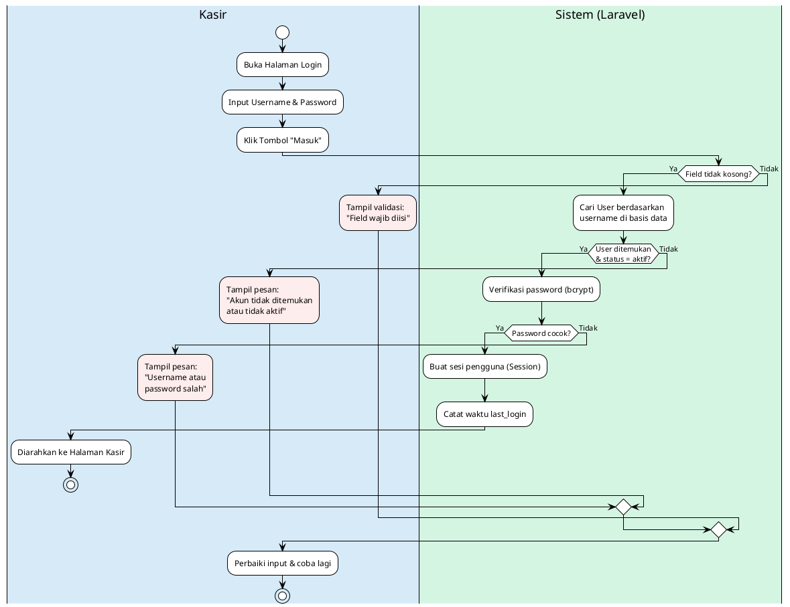
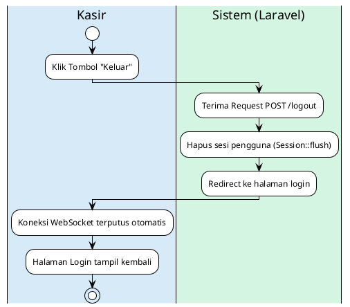
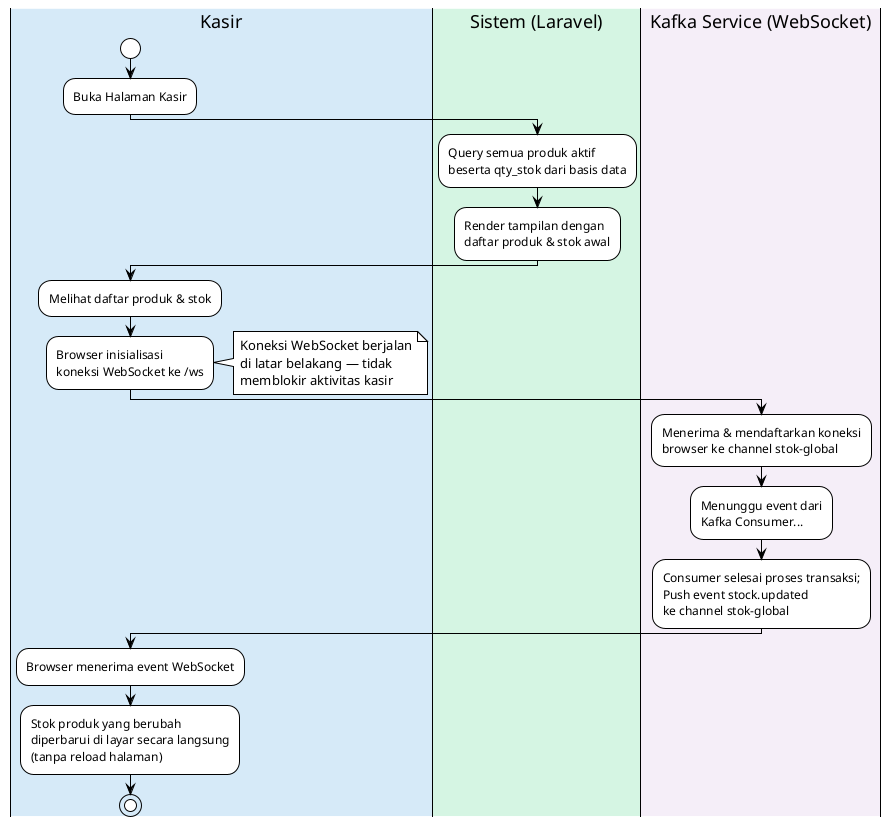
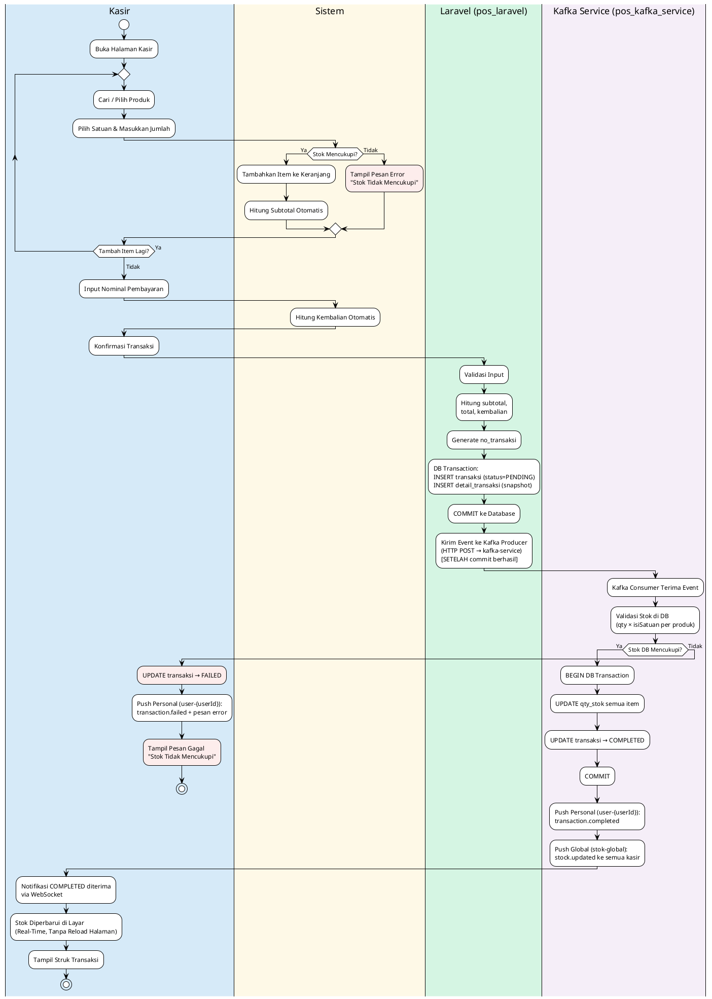
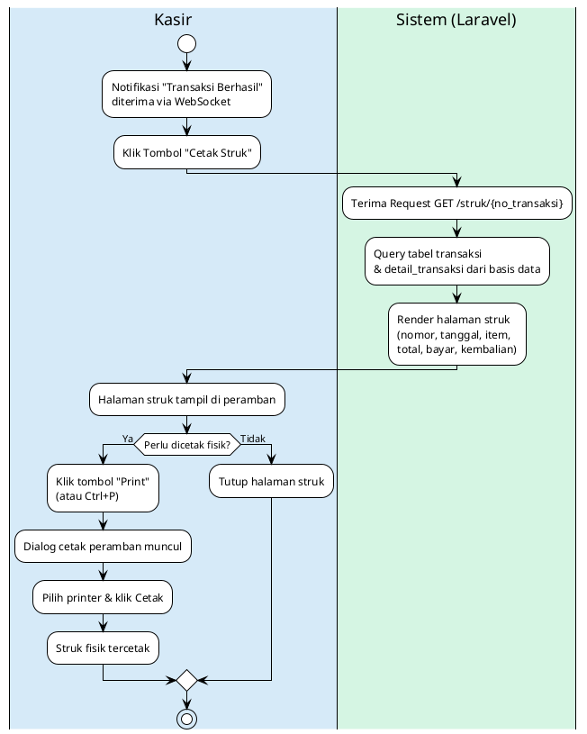
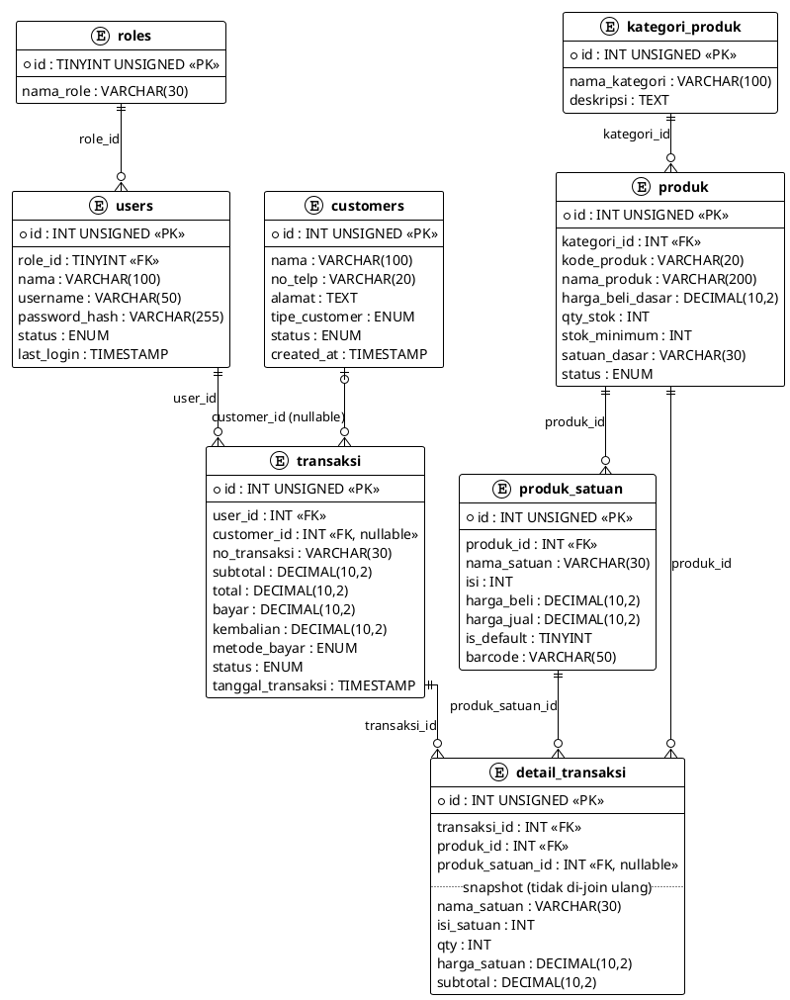

# BAB III
# METODE PELAKSANAAN

## A. Metode Pengumpulan Data

Dalam melaksanakan Projek Mandiri ini, data dan informasi yang dibutuhkan untuk analisis
kebutuhan dan perancangan sistem dikumpulkan melalui beberapa metode berikut.

### 1. Observasi

Observasi dilakukan secara langsung di Toko Melati untuk mengamati proses bisnis yang
berjalan saat ini, terutama pada bagian kasir, meliputi proses transaksi penjualan,
pengecekan stok, perhitungan pembayaran, dan interaksi dengan pelanggan. Hasil observasi
disajikan pada Tabel 3.1.

**Tabel 3.1. Hasil Observasi di Toko Melati**

| Kode | Aspek yang Diamati | Kondisi Saat Ini | Dampak Operasional |
|------|---------------------|-------------------|---------------------|
| O-01 | Proses transaksi penjualan | Manual menggunakan buku nota dan kalkulator | Antrean panjang pada jam sibuk |
| O-02 | Pengecekan stok saat transaksi | Kasir harus menuju gudang secara fisik | Meja kasir ditinggalkan, pelayanan terhenti |
| O-03 | Perhitungan total dan kembalian | Manual dengan kalkulator | Rentan kesalahan saat kondisi ramai |
| O-04 | Pencatatan stok | Tidak ada pencatatan stok menyeluruh | Posisi stok terkini tidak diketahui |
| O-05 | Pencatatan barang rusak | Tidak ada formulir atau catatan khusus | Kerugian tidak terdokumentasi |
| O-06 | Retur ke supplier/distributor | Tidak ada pencatatan retur yang sistematis | Retur terlupakan saat sales berkunjung |
| O-07 | Pendataan pelanggan | Tidak ada pendataan pelanggan | Tidak ada riwayat pembelian pelanggan |
| O-08 | Infrastruktur digital | Belum ada sistem digital terintegrasi | Data tidak tahan gangguan |
| O-09 | Variasi satuan produk | Satu produk dijual dalam beberapa satuan tanpa standar harga yang konsisten | Harga satuan besar tidak konsisten antar kasir |
| O-10 | Proses pembelian ke supplier | Pemesanan lisan, nota disimpan di laci, sebagian kredit tanpa dokumen hutang | Hutang tidak terpantau, nota mudah hilang |
| O-11 | Proses pembuatan laporan | Tidak adanya rekap nota | Laporan tidak tersedia |
| O-12 | Perangkat keras tersedia | Belum ada unit komputer, WiFi tersedia | Semua pencarian dan pencatatan sepenuhnya manual |
| O-13 | Volume operasional | Rata-rata 30 transaksi/hari, ±[xxx] produk aktif | Beban puncak tidak tertangani sistem manual |

Hasil observasi pada Tabel 3.1 merupakan temuan menyeluruh atas kondisi operasional Toko
Melati yang menjadi dasar pengembangan sistem secara keseluruhan (skripsi). Khusus untuk
Projek Mandiri ini, observasi yang menjadi fokus perancangan adalah **O-01, O-02, O-03,
O-04, O-07, O-08, O-09, O-12, dan O-13**, karena berkaitan langsung dengan proses kasir
(transaksi, stok, dan pelanggan). Sementara itu, **O-05, O-06, O-10, dan O-11** berkaitan
dengan proses gudang, pembelian, dan pelaporan yang berada di luar batasan masalah Projek
Mandiri ini, namun tetap menjadi bagian dari pengembangan sistem skripsi yang lebih luas
dan berjalan secara paralel.

### 2. Wawancara

Wawancara dilakukan secara tidak terstruktur dengan pemilik dan staf kasir Toko Melati
untuk memperoleh informasi mengenai kendala operasional sehari-hari, kebutuhan fitur yang
diharapkan, serta kebiasaan pencatatan transaksi dan stok yang selama ini berjalan. Hasil
wawancara digunakan untuk memperkuat dan memvalidasi temuan observasi pada Tabel 3.1.

### 3. Studi Pustaka

Studi pustaka dilakukan dengan mengumpulkan referensi dari jurnal ilmiah, buku, dan
dokumentasi resmi terkait konsep aplikasi kasir, sistem real-time, Apache Kafka, WebSocket,
framework Laravel, dan metode blackbox testing sebagai dasar teori dalam perancangan dan
pengujian sistem (lihat BAB II).

### 4. Studi Dokumentasi

Studi dokumentasi dilakukan dengan mengumpulkan dan menganalisis dokumen transaksi yang
digunakan Toko Melati saat ini, seperti nota penjualan manual dan catatan stok sederhana,
sebagai bahan analisis kebutuhan data dan struktur basis data sistem.

---

## B. Waktu dan Tempat Pelaksanaan

Kegiatan Projek Mandiri ini dilaksanakan di Toko Melati yang berlokasi di Jalan Pahlawan
No. 330, Tanjung, Purwokerto Selatan. Pengembangan sistem dilakukan selama ± [X] bulan,
terhitung mulai [bulan, tahun] hingga [bulan, tahun], dengan jadwal pelaksanaan yang disajikan
pada Tabel 3.2 berikut.

**Tabel 3.2. Jadwal Pelaksanaan Projek Mandiri**

| No | Kegiatan | Bulan 1 | Bulan 2 | Bulan 3 | Bulan 4 |
|----|----------|---------|---------|---------|---------|
| 1  | Observasi dan pengumpulan data kebutuhan | ✓ | | | |
| 2  | Analisis kebutuhan sistem | ✓ | ✓ | | |
| 3  | Perancangan sistem (arsitektur, basis data, antarmuka) | | ✓ | | |
| 4  | Implementasi (pengkodean) | | ✓ | ✓ | |
| 5  | Pengujian sistem (blackbox testing) | | | ✓ | |
| 6  | Perbaikan dan finalisasi | | | ✓ | ✓ |
| 7  | Penyusunan laporan | | | | ✓ |

---

## C. Alat dan Bahan

### 1. Perangkat Keras (*Hardware*)

Perangkat keras yang digunakan dalam pengembangan dan pengoperasian sistem disajikan
pada Tabel 3.3 berikut.

**Tabel 3.3. Spesifikasi Perangkat Keras**

| No | Komponen | Spesifikasi Minimum | Keterangan |
|----|----------|---------------------|------------|
| 1  | Prosesor | Intel Core i5 / AMD Ryzen 5 (atau setara) | Untuk menjalankan Docker dan seluruh container |
| 2  | RAM | 8 GB | Minimal untuk menjalankan Kafka + MySQL + Laravel secara bersamaan |
| 3  | Penyimpanan | 20 GB tersedia | Untuk image Docker, basis data, dan kode sumber |
| 4  | Jaringan | LAN / Wi-Fi | Koneksi antar container dan akses peramban kasir |
| 5  | Perangkat Klien | PC / Laptop / Tablet | Perangkat yang digunakan kasir untuk mengakses aplikasi |

### 2. Perangkat Lunak (*Software*)

Perangkat lunak yang digunakan dalam pengembangan sistem disajikan pada Tabel 3.4 berikut.

**Tabel 3.4. Perangkat Lunak yang Digunakan**

| No | Perangkat Lunak | Versi | Fungsi |
|----|----------------|-------|--------|
| 1  | Docker & Docker Compose | Latest | Kontainerisasi seluruh layanan |
| 2  | Laravel | 11.x | Framework backend PHP |
| 3  | Node.js | 20.x LTS | Layanan Kafka consumer & WebSocket server |
| 4  | Apache Kafka | 3.x | Message broker pemroses event transaksi |
| 5  | MySQL | 8.0 | Sistem manajemen basis data |
| 6  | Nginx | Alpine | Reverse proxy |
| 7  | PHP | 8.2 | Bahasa pemrograman backend |
| 8  | Tailwind CSS | 3.x | Framework CSS antarmuka pengguna |
| 9  | Visual Studio Code | Latest | Editor kode |
| 10 | Google Chrome / Firefox | Latest | Peramban untuk pengujian antarmuka |

---

## D. Metode Pengembangan Perangkat Lunak

Pengembangan aplikasi kasir pada Projek Mandiri ini menggunakan metode pengembangan
perangkat lunak **Waterfall** (*Sequential Linear Development Model*). Model ini dipilih
karena ruang lingkup dan kebutuhan sistem telah terdefinisi dengan jelas sejak awal —
yakni implementasi aplikasi kasir untuk Toko Melati — sehingga pengembangan dapat
dilakukan secara berurutan (*sequential*) tanpa memerlukan iterasi berulang (Sommerville, 2016).

Model Waterfall terdiri atas empat tahapan utama yang dilaksanakan secara berurutan,
sebagaimana ditunjukkan pada Gambar 3.1 berikut.

*Gambar 3.1. Tahapan Metode Waterfall*

---

## E. Analisis Kebutuhan Sistem

### 1. Kebutuhan Fungsional

Kebutuhan fungsional merupakan deskripsi layanan dan fungsi yang harus dapat dilakukan
oleh sistem. Berdasarkan hasil observasi di Toko Melati, kebutuhan fungsional aplikasi kasir
dirumuskan sebagai berikut.

**Tabel 3.5. Kebutuhan Fungsional Sistem**

| No | Kode | Kebutuhan Fungsional |
|----|------|----------------------|
| 1  | KF-01 | Sistem menyediakan fitur autentikasi (*login/logout*) untuk staf kasir |
| 2  | KF-02 | Sistem menampilkan daftar produk beserta harga dan ketersediaan stok |
| 3  | KF-03 | Sistem memungkinkan kasir memilih produk dan satuan (eceran/renteng/karton) saat transaksi |
| 4  | KF-04 | Sistem menghitung subtotal dan total pembayaran secara otomatis |
| 5  | KF-05 | Sistem memproses pembayaran dan menghitung kembalian |
| 6  | KF-06 | Sistem mencatat transaksi penjualan beserta detail itemnya ke basis data |
| 7  | KF-07 | Sistem memperbarui stok barang secara otomatis setelah transaksi berhasil diproses |
| 8  | KF-08 | Sistem menampilkan pembaruan stok secara real-time di antarmuka kasir tanpa memuat ulang halaman |
| 9  | KF-09 | Sistem menampilkan dan mencetak struk transaksi |
| 10 | KF-10 | Sistem mencegah transaksi apabila stok barang tidak mencukupi |

### 2. Kebutuhan Non-Fungsional

Kebutuhan non-fungsional mendefinisikan batasan kualitas yang harus dipenuhi sistem,
sebagaimana diuraikan berikut ini.

- **Ketersediaan (*Availability*):** Sistem harus dapat diakses selama jam operasional
  toko tanpa gangguan yang berarti.
- **Kinerja (*Performance*):** Pembaruan stok real-time harus tersampaikan ke antarmuka
  kasir dalam waktu kurang dari 3 detik setelah transaksi dikonfirmasi.
- **Keamanan (*Security*):** Akses ke sistem dilindungi dengan autentikasi berbasis kata
  sandi yang di-*hash* menggunakan algoritme bcrypt; sesi kasir dikendalikan secara ketat.
- **Kemudahan Penggunaan (*Usability*):** Antarmuka dirancang sederhana dan intuitif
  agar dapat dioperasikan oleh kasir tanpa pelatihan teknis yang mendalam.
- **Konsistensi Data (*Data Consistency*):** Data stok yang tampil di layar kasir harus
  selalu mencerminkan kondisi terkini di basis data.

---

## F. Perancangan Sistem

### 1. Arsitektur Sistem

Aplikasi kasir dibangun dengan arsitektur berlapis yang memisahkan antarmuka pengguna,
logika bisnis, pemrosesan event, dan penyimpanan data ke dalam komponen-komponen
tersendiri yang berjalan di dalam container Docker. Gambaran arsitektur sistem secara
keseluruhan ditunjukkan pada Gambar 3.2 berikut.

*Gambar 3.2. Arsitektur Sistem Aplikasi Kasir*

Alur kerja utama sistem adalah sebagai berikut: kasir memasukkan data transaksi melalui
peramban, Laravel memvalidasi dan mengirimkan event ke Kafka Producer, Kafka
mendistribusikan event ke Consumer di Node.js yang memperbarui stok di MySQL, kemudian
Node.js mendorong notifikasi perubahan stok ke semua klien kasir yang terhubung melalui
WebSocket secara real-time.

### 2. Use Case Diagram

*Use case diagram* menggambarkan interaksi antara aktor (pengguna) dengan fungsi-fungsi
yang tersedia dalam sistem. Aktor utama dalam sistem ini adalah **Kasir**, dengan use case
sebagaimana digambarkan pada Gambar 3.3.

*Gambar 3.3. Use Case Diagram Aplikasi Kasir*

### 3. Alur Aktivitas (*Activity Diagram*)

Alur aktivitas menggambarkan urutan langkah yang dilakukan oleh aktor dan sistem untuk
setiap proses utama aplikasi kasir. Terdapat lima alur aktivitas yang dirancang, meliputi
login, logout, melihat daftar produk dan stok, melakukan transaksi penjualan, dan mencetak
struk transaksi.

#### a. Alur Login

Proses autentikasi kasir ke dalam sistem digambarkan pada Gambar 3.4. Sistem
memverifikasi kredensial kasir melalui tiga lapisan: validasi field, pengecekan keberadaan
akun, dan verifikasi kata sandi menggunakan algoritme bcrypt.

*Gambar 3.4. Alur Login Kasir*

#### b. Alur Logout

Proses logout menghapus sesi aktif kasir dari server sehingga halaman kasir tidak dapat
diakses kembali tanpa login ulang, sebagaimana digambarkan pada Gambar 3.5.

*Gambar 3.5. Alur Logout Kasir*

#### c. Alur Lihat Daftar Produk dan Stok Real-Time

Gambar 3.6 menggambarkan dua fase pengambilan data stok: fase awal (HTTP sinkron saat
halaman dimuat) dan fase pembaruan real-time (push asinkron via WebSocket saat transaksi
lain selesai diproses oleh Consumer).

*Gambar 3.6. Alur Lihat Daftar Produk dan Pembaruan Stok Real-Time*

#### d. Alur Transaksi Penjualan

Alur transaksi penjualan merupakan proses utama dan terkompleks dalam sistem ini.
Gambar 3.7 menggambarkan alur lengkap dari pemilihan produk oleh kasir hingga
pembaruan stok di basis data melalui arsitektur event-driven berbasis Kafka dan WebSocket.

*Gambar 3.7. Alur Proses Transaksi Penjualan*

#### e. Alur Cetak Struk

Setelah transaksi dinyatakan COMPLETED oleh Consumer, kasir dapat mencetak struk
sebagai bukti transaksi. Gambar 3.8 menggambarkan alur dari klik tombol cetak hingga
struk fisik dicetak melalui dialog cetak peramban.

*Gambar 3.8. Alur Cetak Struk Transaksi*

### 4. Perancangan Basis Data

Perancangan basis data difokuskan pada tabel-tabel yang mendukung modul kasir. Relasi
antar tabel digambarkan pada Gambar 3.9, sedangkan deskripsi setiap tabel diuraikan
pada Tabel 3.6 hingga Tabel 3.13.

*Gambar 3.9. Diagram Relasi Tabel Modul Kasir*

**Tabel 3.6. Deskripsi Tabel `transaksi`**

| Nama Kolom | Tipe Data | Keterangan |
|------------|-----------|------------|
| id | BIGINT UNSIGNED | Primary key, auto increment |
| no_transaksi | VARCHAR(20) | Nomor unik transaksi (misal: TRX-20260531-001) |
| user_id | INT UNSIGNED | Foreign key ke tabel `users` (kasir yang memproses) |
| customer_id | INT UNSIGNED | Foreign key ke `customers`, nullable (walk-in) |
| subtotal | DECIMAL(10,2) | Jumlah seluruh subtotal item |
| total | DECIMAL(10,2) | Nilai akhir yang harus dibayar (sama dengan subtotal) |
| bayar | DECIMAL(10,2) | Nominal uang yang dibayarkan pelanggan |
| kembalian | DECIMAL(10,2) | Selisih bayar dan total |
| metode_bayar | ENUM | tunai, transfer, qris |
| status | ENUM | PENDING, COMPLETED, FAILED, CANCELLED |
| tanggal_transaksi | TIMESTAMP | Waktu transaksi terjadi |

**Tabel 3.7. Deskripsi Tabel `detail_transaksi`**

| Nama Kolom | Tipe Data | Keterangan |
|------------|-----------|------------|
| id | BIGINT UNSIGNED | Primary key |
| transaksi_id | BIGINT UNSIGNED | Foreign key ke tabel `transaksi` |
| produk_id | BIGINT UNSIGNED | Referensi produk |
| produk_satuan_id | BIGINT UNSIGNED | Referensi satuan produk |
| nama_produk | VARCHAR(100) | Snapshot nama produk saat transaksi |
| nama_satuan | VARCHAR(30) | Snapshot nama satuan saat transaksi |
| isi_satuan | INT | Snapshot konversi satuan (misal karton = 96 pcs) |
| qty | INT | Jumlah item yang dibeli |
| harga_satuan | DECIMAL(10,2) | Snapshot harga saat transaksi |
| subtotal | DECIMAL(10,2) | harga_satuan × qty |

**Tabel 3.8. Deskripsi Tabel `produk`**

| Nama Kolom | Tipe Data | Keterangan |
|------------|-----------|------------|
| id | BIGINT UNSIGNED | Primary key |
| kode_produk | VARCHAR(20) | Kode unik produk |
| nama_produk | VARCHAR(100) | Nama produk |
| kategori_id | BIGINT UNSIGNED | Foreign key ke tabel `kategori` |
| qty_stok | INT | Stok dalam satuan terkecil (satuan dasar) |
| satuan_dasar | VARCHAR(20) | Satuan terkecil (misal: pcs, gram) |
| status | ENUM | aktif, nonaktif |

**Tabel 3.9. Deskripsi Tabel `produk_satuan`**

| Nama Kolom | Tipe Data | Keterangan |
|------------|-----------|------------|
| id | BIGINT UNSIGNED | Primary key |
| produk_id | BIGINT UNSIGNED | Foreign key ke tabel `produk` |
| nama_satuan | VARCHAR(30) | Nama satuan (pcs, renteng, karton) |
| isi | INT | Jumlah satuan dasar dalam 1 satuan ini |
| harga_beli | DECIMAL(10,2) | Harga beli per satuan |
| harga_jual | DECIMAL(10,2) | Harga jual per satuan |
| is_default | TINYINT | 1 = satuan default di form kasir |

**Tabel 3.10. Deskripsi Tabel `roles`**

Tabel `roles` adalah tabel referensi yang mendefinisikan peran (*role*) pengguna dalam
sistem. Tabel ini bersifat statis dan hanya dikelola oleh owner — kasir tidak dapat
mengubah isi tabel ini.

| Nama Kolom | Tipe Data | Keterangan |
|------------|-----------|------------|
| id | TINYINT UNSIGNED | Primary key, auto increment |
| nama_role | VARCHAR(30) | Nama peran pengguna (kasir, admin_gudang, owner) |

**Tabel 3.11. Deskripsi Tabel `users`**

Tabel `users` menyimpan data akun seluruh pengguna sistem, termasuk staf kasir. Tabel
ini digunakan pada proses autentikasi (KF-01) dan sebagai referensi pencatatan kasir
yang memproses transaksi melalui kolom `user_id` di tabel `transaksi`.

| Nama Kolom | Tipe Data | Keterangan |
|------------|-----------|------------|
| id | INT UNSIGNED | Primary key, auto increment |
| role_id | TINYINT UNSIGNED | Foreign key ke tabel `roles` |
| nama | VARCHAR(100) | Nama lengkap pengguna |
| username | VARCHAR(50) | Username untuk login, bersifat unik |
| password_hash | VARCHAR(255) | Kata sandi yang di-*hash* menggunakan bcrypt |
| status | ENUM | aktif, nonaktif — pengguna nonaktif tidak dapat login |
| last_login | TIMESTAMP | Waktu terakhir pengguna berhasil login, nullable |
| created_at | TIMESTAMP | Waktu akun dibuat |

**Tabel 3.12. Deskripsi Tabel `kategori_produk`**

Tabel `kategori_produk` menyimpan data kategori barang dagangan. Tabel ini digunakan
sebagai referensi pengelompokan produk yang tampil di halaman kasir (misalnya:
Sembako, Minuman, Rokok). Kategori dikelola oleh admin gudang atau owner, bukan
oleh kasir.

| Nama Kolom | Tipe Data | Keterangan |
|------------|-----------|------------|
| id | INT UNSIGNED | Primary key, auto increment |
| nama_kategori | VARCHAR(100) | Nama kategori produk, bersifat unik |
| deskripsi | TEXT | Keterangan tambahan kategori, nullable |
| created_at | TIMESTAMP | Waktu kategori dibuat |

**Tabel 3.13. Deskripsi Tabel `customers`**

Tabel `customers` menyimpan data pelanggan tetap Toko Melati. Tabel ini digunakan
pada saat kasir melakukan transaksi penjualan dengan memilih pelanggan yang sudah
terdaftar. Pemilihan customer bersifat opsional — transaksi tanpa customer (*walk-in*)
tetap valid dengan kolom `customer_id` bernilai NULL pada tabel `transaksi`.

| Nama Kolom | Tipe Data | Keterangan |
|------------|-----------|------------|
| id | INT UNSIGNED | Primary key, auto increment |
| nama | VARCHAR(100) | Nama lengkap pelanggan |
| no_telp | VARCHAR(20) | Nomor telepon pelanggan, bersifat unik |
| alamat | TEXT | Alamat pelanggan, nullable |
| tipe_customer | ENUM | reguler, grosir — menentukan kategori harga |
| status | ENUM | aktif, nonaktif |
| created_at | TIMESTAMP | Waktu data pelanggan dibuat |
| updated_at | TIMESTAMP | Waktu terakhir data diperbarui |

### 5. Rancangan Antarmuka

Antarmuka aplikasi kasir dirancang dengan prinsip kesederhanaan dan efisiensi agar staf
kasir dapat memproses transaksi dengan cepat. Terdapat lima layar utama dalam aplikasi
kasir, yaitu:

**a. Halaman Login**

Halaman ini menampilkan formulir autentikasi yang memuat kolom *username* dan kata sandi.
Akses ke halaman kasir hanya dapat dilakukan setelah kasir berhasil terautentikasi.

*[Gambar 3.10. Rancangan Halaman Login — sisipkan screenshot/wireframe di sini]*

**b. Halaman Dashboard Kasir**

Halaman ini ditampilkan setelah kasir berhasil login dan berfungsi sebagai halaman
beranda aplikasi. Halaman ini menampilkan informasi ringkas seperti nama kasir yang
sedang login, serta navigasi cepat menuju halaman Transaksi dan halaman Pantau Stok.

*[Gambar 3.11. Rancangan Halaman Dashboard Kasir — sisipkan screenshot/wireframe di sini]*

**c. Halaman Pantau Stok Real-Time**

Halaman ini menampilkan daftar seluruh produk beserta jumlah stok terkini dalam satuan
dasar. Data stok pada halaman ini diperbarui secara otomatis melalui WebSocket setiap
kali terjadi transaksi yang memengaruhi stok produk, tanpa memerlukan pemuatan ulang
halaman. Halaman ini merupakan implementasi langsung dari KF-02 dan KF-08.

*[Gambar 3.12. Rancangan Halaman Pantau Stok Real-Time — sisipkan screenshot/wireframe di sini]*

**d. Halaman Transaksi**

Halaman transaksi terbagi menjadi dua panel: (1) panel kiri menampilkan daftar produk
beserta stok terkini; dan (2) panel kanan menampilkan keranjang belanja dengan daftar
item yang dipilih, subtotal per item, total keseluruhan, kolom input nominal pembayaran,
dan informasi kembalian. Indikator stok berwarna merah akan muncul secara otomatis
apabila stok suatu produk mencapai nol tanpa perlu memuat ulang halaman.

*[Gambar 3.13. Rancangan Halaman Transaksi — sisipkan screenshot/wireframe di sini]*

**e. Halaman Struk Transaksi**

Setelah transaksi berhasil diproses, sistem menampilkan struk digital yang memuat nomor
transaksi, tanggal dan jam, daftar item beserta satuan dan harga, total pembayaran,
uang bayar, dan kembalian. Struk dapat dicetak langsung melalui fungsi cetak peramban.

*[Gambar 3.14. Rancangan Halaman Struk Transaksi — sisipkan screenshot/wireframe di sini]*

---

## G. Implementasi Sistem

Implementasi dilaksanakan berdasarkan rancangan yang telah disusun pada tahap perancangan,
dengan urutan pengerjaan mengikuti dependensi antar komponen.

**Tahap 1 — Konfigurasi Infrastruktur**
Seluruh layanan (Laravel, Node.js, Kafka, MySQL, Nginx) dikonfigurasi menggunakan
Docker Compose sehingga dapat dijalankan sebagai satu kesatuan lingkungan yang terisolasi.
Setiap layanan berkomunikasi menggunakan nama *hostname* sesuai nama *service* Docker
(bukan `localhost`) untuk memastikan resolusi nama yang benar di dalam jaringan container.

**Tahap 2 — Basis Data dan Migrasi**
Skema basis data dibuat menggunakan fitur *database migration* Laravel, yang memungkinkan
pembuatan dan perubahan skema tabel secara terstruktur dan dapat dilacak melalui *version control*.
Data awal produk dan pengguna dimasukkan menggunakan fitur *database seeder*.

**Tahap 3 — Backend Laravel (API dan Logika Bisnis)**
Implementasi backend mengikuti *Service Pattern* — logika bisnis dipisahkan ke dalam kelas
*Service* tersendiri agar Controller tetap ringkas. Validasi input menggunakan *FormRequest*
Laravel. Komunikasi dengan Kafka dilakukan melalui HTTP POST ke layanan Node.js
(bukan langsung ke Kafka broker), sesuai topologi yang telah dirancang.

**Tahap 4 — Layanan Kafka dan WebSocket (Node.js)**
Layanan Node.js menjalankan dua komponen secara bersamaan: Kafka *consumer* yang
mendengarkan event dari topic `transaction.created` dan memproses pembaruan stok di MySQL,
serta WebSocket *server* yang mengelola koneksi dari peramban kasir dan mendorong
pembaruan stok begitu Consumer selesai memproses event.

**Tahap 5 — Antarmuka Kasir (Blade + Tailwind CSS + Axios)**
Antarmuka pengguna dibangun menggunakan Blade template engine dengan Tailwind CSS untuk
penataan visual, terdiri atas halaman Login, Dashboard, Pantau Stok, Transaksi, dan Struk
sesuai rancangan pada Gambar 3.10 hingga Gambar 3.14. Koneksi WebSocket dari peramban
kasir diinisialisasi menggunakan JavaScript native (`new WebSocket(...)`) saat halaman
Dashboard, Pantau Stok, dan Transaksi dimuat, sehingga pembaruan stok dapat diterima
secara langsung tanpa memerlukan *refresh* manual.

---

## H. Pengujian Sistem

Pengujian sistem dilakukan menggunakan metode **blackbox testing** dengan menyusun
skenario uji (*test case*) berdasarkan kebutuhan fungsional yang telah ditetapkan pada
Tabel 3.5. Skenario uji dikelompokkan berdasarkan halaman/fungsi pada aplikasi kasir agar
hasil pengujian lebih mudah ditelusuri pada saat perbaikan, sebagaimana disajikan pada
Tabel 3.14 hingga Tabel 3.17 berikut. Setiap skenario uji mencatat kondisi awal, langkah
pengujian, hasil yang diharapkan, dan hasil aktual.

**Tabel 3.14. Pengujian Halaman Login dan Logout**

| No | Kode KF | Skenario Uji | Kondisi Awal | Input | Output yang Diharapkan | Hasil |
|----|---------|-------------|-------------|-------|----------------------|-------|
| 1 | KF-01 | Login dengan kredensial valid | Belum login | Username & password benar | Diarahkan ke halaman Dashboard Kasir | - |
| 2 | KF-01 | Login dengan password salah | Belum login | Username benar, password salah | Pesan error "Username atau password salah", tetap di halaman login | - |
| 3 | KF-01 | Login dengan field kosong | Belum login | Username dan/atau password tidak diisi | Pesan validasi "Field wajib diisi", tetap di halaman login | - |
| 4 | KF-01 | Logout dari sistem | Sudah login | Klik tombol "Keluar" | Sesi berakhir dan diarahkan kembali ke halaman login | - |

**Tabel 3.15. Pengujian Halaman Dashboard dan Pantau Stok**

| No | Kode KF | Skenario Uji | Kondisi Awal | Input | Output yang Diharapkan | Hasil |
|----|---------|-------------|-------------|-------|----------------------|-------|
| 1 | KF-02 | Tampil daftar produk dan stok | Sudah login, membuka halaman Pantau Stok | — | Daftar produk beserta stok terkini (qty_stok) tampil | - |
| 2 | KF-08 | Pembaruan stok real-time | Halaman Pantau Stok terbuka di perangkat A | Transaksi penjualan diproses hingga COMPLETED di perangkat B | Stok produk terkait di perangkat A berubah otomatis tanpa reload halaman | - |

**Tabel 3.16. Pengujian Halaman Transaksi**

| No | Kode KF | Skenario Uji | Kondisi Awal | Input | Output yang Diharapkan | Hasil |
|----|---------|-------------|-------------|-------|----------------------|-------|
| 1 | KF-03 | Pilih produk dan satuan | Halaman Transaksi aktif | Klik produk, pilih satuan "karton" | Produk masuk keranjang dengan harga sesuai satuan karton | - |
| 2 | KF-04 | Hitung subtotal dan total otomatis | Keranjang berisi ≥1 item | Tambah/hapus item dari keranjang | Subtotal per item dan total keseluruhan diperbarui otomatis | - |
| 3 | KF-05 | Proses pembayaran valid | Keranjang tidak kosong, total = Rp50.000 | Input bayar = Rp100.000 | Kembalian = Rp50.000 dihitung otomatis, transaksi dikonfirmasi | - |
| 4 | KF-06 | Simpan transaksi ke basis data | Transaksi dikonfirmasi | — | Data tersimpan pada tabel `transaksi` (status PENDING) dan `detail_transaksi` (snapshot item) | - |
| 5 | KF-07 | Stok berkurang setelah transaksi berhasil | Stok produk A = 200 pcs (satuan dasar) | Jual 2 karton (isi = 96 pcs/karton) | Status transaksi menjadi COMPLETED, stok produk A berkurang menjadi 200 − (2×96) = 8 pcs | - |
| 6 | KF-10 | Cegah transaksi jika stok tidak mencukupi | Stok produk B = 50 pcs (satuan dasar) | Jual 1 karton (isi = 96 pcs/karton) | Status transaksi menjadi FAILED, pesan "Stok tidak mencukupi" tampil, stok produk B tidak berubah | - |

**Tabel 3.17. Pengujian Halaman Struk Transaksi**

| No | Kode KF | Skenario Uji | Kondisi Awal | Input | Output yang Diharapkan | Hasil |
|----|---------|-------------|-------------|-------|----------------------|-------|
| 1 | KF-09 | Tampil struk transaksi | Transaksi berstatus COMPLETED | Notifikasi berhasil diterima, klik tombol "Cetak Struk" | Halaman struk menampilkan nomor transaksi, tanggal, daftar item, total, bayar, dan kembalian | - |
| 2 | KF-09 | Cetak struk fisik | Halaman struk tampil | Klik tombol "Print" (atau Ctrl+P) | Dialog cetak peramban muncul dan struk dapat dicetak | - |

*Keterangan kolom Hasil: diisi saat pengujian dilaksanakan — Lulus / Gagal*
